<div align="center">
  

  <p align="center">
    <a href="https://steamcommunity.com/id/ELbot28/"><b>🎮 Steam Profile</b></a> &nbsp;•&nbsp;
    <a href="https://www.linkedin.com/in/mayer-salib"><b>💼 LinkedIn</b></a> &nbsp;•&nbsp;
    <a href="mailto:marounsalib28@gmail.com"><b>📫 Email</b></a> &nbsp;•&nbsp;
    <code>Discord: EL_bot</code>
  </p>
</div>

---

### ⚡ Featured Systems

#### 🎮 [GreenLuma Stealth Manager](https://github.com/Mayer-ELbot/GreenLuma-Stealth-Manager)
> Standalone Windows manager and stealth injector for GreenLuma with seamless Steam family support.
* **Zero-BOM INI Engine**: Writes `AppList.ini` with BOM-free UTF-8 encoding, preventing license parsing failures in Steam.
* **Slot 90 Enforcer**: Automatically arranges base game IDs into Slot 90 for proper account ownership detection.
* **Zero Residuals**: Injects stealth DLLs into runtime and cleanly purges all temporary hooks on application exit.
* `C#` • `Win32 APIs` • `Steam VDF Engine` • `MIT License`

<br>

#### 🚀 [PC Booster](https://github.com/Mayer-ELbot/PC-Booster)
> Calm, local-first Windows PC monitoring and reversible system optimization toolkit.
* **Gentle Optimization**: Reversible user tweaks, startup app manager, and clean temporary storage management.
* **Zero Force-Kills**: Never forcibly kills background apps or disables Windows system integrity services.
* **100% Offline**: Zero telemetry, zero external network calls, completely local configuration.
* `Python` • `PowerShell` • `Windows APIs` • `Standalone EXE`

<br>

#### 🛡️ [NightByte AI](https://github.com/Mayer-ELbot/NightByte)
> Context-aware auto-shutdown and download guardian for Windows gaming and torrent setups.
* **Network Guardian**: Async connectivity monitor that automatically freezes shutdown timers if internet drops overnight.
* **Multi-Launcher Engine**: Native state-flag parser for Steam (`appmanifest`), Epic Games, EA, Battle.net, and Torrent clients.
* **Anti-AFK & HUD**: Translucent countdown HUD with instant snooze controls and sleep-prevention locks.
* `Python` • `PySide6 / Qt` • `Asyncio` • `Windows Power Management`

---

### 🐍 Contribution Activity

<div align="center">
  <picture>
    <source media="(prefers-color-scheme: dark)" srcset="https://raw.githubusercontent.com/Mayer-ELbot/Mayer-ELbot/output/github-contribution-grid-snake-dark.svg">
    <source media="(prefers-color-scheme: light)" srcset="https://raw.githubusercontent.com/Mayer-ELbot/Mayer-ELbot/output/github-contribution-grid-snake.svg">
    
  </picture>
</div>

---

### 🔄 Live Activity & Shipped Releases

<!-- AUTO_UPDATE:START -->
> 🔄 **Live Pulse (Auto-Updated):** `Last sync: 2026-10-16 19:24 UTC`

- 📦 **[PC-Booster](https://github.com/Mayer-ELbot/PC-Booster)**: Shipped **PC Booster Pro v1.0.0 (Official Release)** *(Oct 16, 2026)*
- 📦 **[GreenLuma-Stealth-Manager](https://github.com/Mayer-ELbot/GreenLuma-Stealth-Manager)**: Shipped **v1.6.0 - Zero-Collision Command Deck & Fluid GPU Animations** *(Oct 16, 2026)*
- 🚀 **[GreenLuma-Stealth-Manager](https://github.com/Mayer-ELbot/GreenLuma-Stealth-Manager)**: `Pushed commits` *(Oct 14, 2026)*
- 📦 **[PC-Booster](https://github.com/Mayer-ELbot/PC-Booster)**: Shipped **PC Booster 0.3.0** *(Oct 15, 2026)*
<!-- AUTO_UPDATE:END -->

---

### 🛠️ Core Tech Stack

```text
Languages     ::  C, C++, C#, Python, PowerShell, Bash, SQL
Frameworks    ::  Win32 API, PySide6 / Qt, .NET, Steamworks VDF
AI Tooling    ::  LLM Workflows, Anthropic Claude, Antigravity, Prompt Engineering
Platforms     ::  Windows 10/11 (Kernel & Tweaks), Linux Environments
```

---

<div align="center">
  <p><i>"Be loyal to what matters."</i> — <b>Arthur Morgan</b></p>
  <sub>Mayer Mamdouh (EL_bot) • Systems &amp; Desktop Software</sub>
</div>
