<div align="center">
  <!-- Animated Cyberpunk Workstation HUD -->
  

  <!-- Clean Minimalist Links -->
  <p align="center">
    <a href="https://steamcommunity.com/id/ELbot28/"><b>🎮 Steam Profile</b></a> &nbsp;•&nbsp;
    <a href="https://www.linkedin.com/in/mayer-salib"><b>💼 LinkedIn</b></a> &nbsp;•&nbsp;
    <a href="mailto:marounsalib28@gmail.com"><b>📫 Email</b></a> &nbsp;•&nbsp;
    <code>Discord: EL_bot</code>
  </p>
</div>

---

### ⚡ Featured Systems Architecture

<div align="center">
  <!-- Animated Bento 2.0 Systems Showcase -->
  
</div>

<p align="center">
  <a href="https://github.com/Mayer-ELbot/GreenLuma-Stealth-Manager"><b>[ 🎮 Explore GreenLuma Manager ]</b></a> &nbsp;&nbsp;•&nbsp;&nbsp;
  <a href="https://github.com/Mayer-ELbot/PC-Booster"><b>[ ⚡ Explore PC Booster ]</b></a> &nbsp;&nbsp;•&nbsp;&nbsp;
  <a href="https://github.com/Mayer-ELbot/NightByte"><b>[ 🛡️ Explore NightByte AI ]</b></a>
</p>

---

### 🐍 Contribution Activity

<div align="center">
  <picture>
    <source media="(prefers-color-scheme: dark)" srcset="https://raw.githubusercontent.com/Mayer-ELbot/Mayer-ELbot/output/github-contribution-grid-snake-dark.svg">
    <source media="(prefers-color-scheme: light)" srcset="https://raw.githubusercontent.com/Mayer-ELbot/Mayer-ELbot/output/github-contribution-grid-snake.svg">
    
  </picture>
</div>

---

### 🔄 Live Activity & Shipped Releases

<!-- AUTO_UPDATE:START -->
> 🔄 **Live Pulse (Auto-Updated):** `Last sync: 2026-10-16 19:28 UTC`

- 📦 **[PC-Booster](https://github.com/Mayer-ELbot/PC-Booster)**: Shipped **PC Booster Pro v1.0.0 (Official Release)** *(Oct 16, 2026)*
- 📦 **[GreenLuma-Stealth-Manager](https://github.com/Mayer-ELbot/GreenLuma-Stealth-Manager)**: Shipped **v1.6.0 - Zero-Collision Command Deck & Fluid GPU Animations** *(Oct 16, 2026)*
- 🚀 **[GreenLuma-Stealth-Manager](https://github.com/Mayer-ELbot/GreenLuma-Stealth-Manager)**: `Pushed commits` *(Oct 14, 2026)*
- 📦 **[PC-Booster](https://github.com/Mayer-ELbot/PC-Booster)**: Shipped **PC Booster 0.3.0** *(Oct 15, 2026)*
<!-- AUTO_UPDATE:END -->

---

### 🛠️ Core Tech Stack

```text
Languages     ::  C, C++, C#, Python, PowerShell, Bash, SQL
Frameworks    ::  Win32 API, PySide6 / Qt, .NET, Steamworks VDF
AI Tooling    ::  LLM Workflows, Anthropic Claude, Antigravity, Prompt Engineering
Platforms     ::  Windows 10/11 (Kernel & Tweaks), Linux Environments
```

---

<div align="center">
  <p><i>"Be loyal to what matters."</i> — <b>Arthur Morgan</b></p>
  <sub>Mayer Mamdouh (EL_bot) • Systems &amp; Desktop Software • Alexandria, Egypt</sub>
</div>
