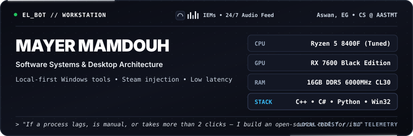

<div align="center">
  <!-- Animated Workstation HUD (Titanium Dark) -->
  

  <!-- Clean Minimalist Links -->
  <p align="center">
    <a href="https://steamcommunity.com/id/ELbot28/"><b>🎮 Steam Profile</b></a> &nbsp;•&nbsp;
    <a href="https://www.linkedin.com/in/mayer-salib"><b>💼 LinkedIn</b></a> &nbsp;•&nbsp;
    <a href="mailto:marounsalib28@gmail.com"><b>📫 Email</b></a> &nbsp;•&nbsp;
    <code>Discord: EL_bot</code>
  </p>
</div>

```ini
; mayer@aswan:~$ fetch_system_info --------------------------------------------------------------------

[ Identity & Education ]                  [ Dev Stack & Workflow ]
Name      = Mayer Mamdouh Salib           Languages = C, C++, C#, Python, PowerShell
Alias     = EL_bot                        Workflow  = Vibecoding + AI-Augmented Builder
College   = Computing & CS (Sem 3) @ AASTMT Tooling   = Cursor, Antigravity, Win32 APIs
Location  = Aswan, Egypt                  Focus     = Local-First Desktop Utilities
Audio     = 24/7 Music (IEMs Setup)       

[ Hardware Rig & Gaming ]                 [ System Specs ]
Expertise = PC Hardware & Undervolting    CPU       = Ryzen 5 8400F (Tuned)
Persona   = Gamer (Story, Horror, FPS)    GPU       = RX 7600 Black Edition
Display   = 240Hz Monitor                 Memory    = 16GB DDR5 6000MHz CL30
Cooling   = Thermalright PA140            Status    = Undervolted, Clean & Optimized
; ------------------------------------------------------------------------------------------------------
```

---

### ⚡ Open-Source Projects

* 🎮 **[GreenLuma Stealth Manager](https://github.com/Mayer-ELbot/GreenLuma-Stealth-Manager)** — Standalone Steam runtime injector with BOM-free UTF-8 parsing, Slot 90 license priority, and clean exit reverts. `C#` • `Win32` • `Steamworks`
* 🚀 **[PC Booster](https://github.com/Mayer-ELbot/PC-Booster)** — Calm, local-first Windows PC monitoring and reversible latency optimization toolkit with zero telemetry. `Python` • `PowerShell` • `Standalone EXE`
* 🛡️ **[NightByte AI](https://github.com/Mayer-ELbot/NightByte)** — Context-aware auto-shutdown and download guardian featuring Network Guardian protection for Steam, Epic, and Torrents. `Python` • `PySide6 / Qt` • `Asyncio`
* 📚 **[AAST Course Hub](https://github.com/Mayer-ELbot/Website-for-AAST-material)** — Academic resource hub aggregating course materials and lecture slides for Computer Science students. `Web` • `Open Source`

---

### 🐍 Contribution Activity

<div align="center">
  <picture>
    <source media="(prefers-color-scheme: dark)" srcset="https://raw.githubusercontent.com/Mayer-ELbot/Mayer-ELbot/output/github-contribution-grid-snake-dark.svg">
    <source media="(prefers-color-scheme: light)" srcset="https://raw.githubusercontent.com/Mayer-ELbot/Mayer-ELbot/output/github-contribution-grid-snake.svg">
    
  </picture>
</div>

---

### 🔄 Live Activity & Shipped Releases

<!-- AUTO_UPDATE:START -->
> 🔄 **Live Pulse (Auto-Updated):** `Last sync: 2026-10-16 19:42 UTC`

- 📦 **[PC-Booster](https://github.com/Mayer-ELbot/PC-Booster)**: Shipped **PC Booster Pro v1.0.0 (Official Release)** *(Oct 16, 2026)*
- 📦 **[GreenLuma-Stealth-Manager](https://github.com/Mayer-ELbot/GreenLuma-Stealth-Manager)**: Shipped **v1.6.0 - Zero-Collision Command Deck & Fluid GPU Animations** *(Oct 16, 2026)*
- 🚀 **[GreenLuma-Stealth-Manager](https://github.com/Mayer-ELbot/GreenLuma-Stealth-Manager)**: `Pushed commits` *(Oct 14, 2026)*
- 📦 **[PC-Booster](https://github.com/Mayer-ELbot/PC-Booster)**: Shipped **PC Booster 0.3.0** *(Oct 15, 2026)*
<!-- AUTO_UPDATE:END -->

---

### 🛠️ Core Tech Stack

```text
Languages     ::  C, C++, C#, Python, PowerShell, Bash, SQL
Frameworks    ::  Win32 API, PySide6 / Qt, .NET, Steamworks VDF
AI Tooling    ::  LLM Workflows, Anthropic Claude, Antigravity, Prompt Engineering
Platforms     ::  Windows 10/11 (Kernel & Tweaks), Linux Environments
```

---

<div align="center">
  <p><i>"Be loyal to what matters."</i> — <b>Arthur Morgan</b></p>
  <sub>Mayer Mamdouh (EL_bot) • Systems &amp; Desktop Software • Aswan, Egypt</sub>
</div>
