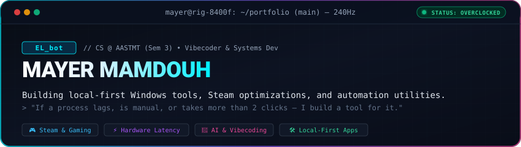
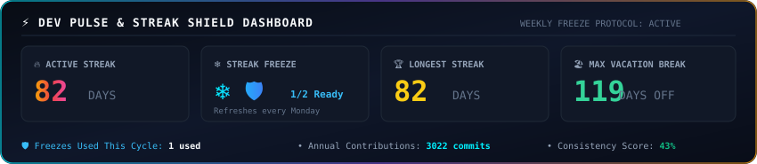

<div align="center">
  <!-- Custom Vector Cyberpunk Terminal Header -->
  

  <!-- Clean Connect Badges -->
  <p align="center">
    <a href="https://steamcommunity.com/id/ELbot28/" target="_blank">
      
    </a>
    <a href="https://www.linkedin.com/in/mayer-salib" target="_blank">
      
    </a>
    <a href="https://discord.com" target="_blank">
      
    </a>
    <a href="mailto:marounsalib28@gmail.com">
      
    </a>
  </p>
</div>

```ini
; mayer@maroun:~$ fetch_system_info --------------------------------------------------------------------

[ Identity & Vibe ]                       [ Dev Stack & Workflow ]
Name      = Mayer Mamdouh Salib           Languages = C, C++, C#, Python, PowerShell
Alias     = EL_bot                        Workflow  = Vibecoding + AI-Augmented Dev
Edu       = CS (Sem 3) @ AASTMT           Tooling   = import antigravity;
Audio     = 24/7 Music (IEMs Setup)       Focus     = Local-first utilities & automation
Anti_Vibe = Apple / Mac Ecosystem         

[ Hardware Rig & Gaming ]                 [ System Specs ]
Expertise = PC Hardware & Undervolting    CPU       = Ryzen 5 8400F
Persona   = Gamer (Story, Horror, FPS)    GPU       = RX 7600 Black Edition
Display   = 240Hz Monitor                 Memory    = 16GB DDR5 6000MHz CL30
Cooling   = Thermalright PA140            Status    = Undervolted, Optimized & Clean
; ------------------------------------------------------------------------------------------------------
```

---

### 🕹️ The Arcade Zone // 240FPS Chomp

<div align="center">
  <!-- Animated Pacman Eating Pellets & Latency -->
  
</div>

<br>

<div align="center">
  <!-- Contribution Snake Game Animation -->
  <picture>
    <source media="(prefers-color-scheme: dark)" srcset="https://raw.githubusercontent.com/Mayer-ELbot/Mayer-ELbot/output/github-contribution-grid-snake-dark.svg">
    <source media="(prefers-color-scheme: light)" srcset="https://raw.githubusercontent.com/Mayer-ELbot/Mayer-ELbot/output/github-contribution-grid-snake.svg">
    
  </picture>
</div>

---

### 🛡️ Dev Pulse & Streak Freeze Dashboard

> *Powered by a custom weekly freeze engine: 2 ❄️ Streak Freezes renewed every Monday to protect rest days and keep the streak alive.*

<div align="center">
  
</div>

---

### 📦 Flagship Open-Source Systems

<table>
  <tr>
    <td width="50%" valign="top">
      <h3 align="center">🎮 <a href="https://github.com/Mayer-ELbot/GreenLuma-Stealth-Manager">GreenLuma Stealth Manager</a></h3>
      <p align="center">
        
        
        
      </p>
      <p>Automated standalone Windows manager for GreenLuma. Eliminates manual INI edits, handles UTF-8 BOM issues, enforces Slot 90 priority, automates cache cleanup, and injects stealth files safely without modifying permanent Steam files.</p>
      <p align="center"><b><a href="https://github.com/Mayer-ELbot/GreenLuma-Stealth-Manager">⚡ View Repository →</a></b></p>
    </td>
    <td width="50%" valign="top">
      <h3 align="center">⚡ <a href="https://github.com/Mayer-ELbot/PC-Booster">PC Booster</a></h3>
      <p align="center">
        
        
        
      </p>
      <p>A calm, local-first Windows PC monitoring and reversible optimization toolkit. Live CPU/RAM/GPU monitoring, gentle memory pressure handling without force-closing apps, storage cleanup to Recycle Bin, and 100% reversible OS tweaks.</p>
      <p align="center"><b><a href="https://github.com/Mayer-ELbot/PC-Booster">⚡ View Repository →</a></b></p>
    </td>
  </tr>
  <tr>
    <td width="50%" valign="top">
      <h3 align="center">🛡️ <a href="https://github.com/Mayer-ELbot/NightByte">NightByte AI</a></h3>
      <p align="center">
        
        
        
      </p>
      <p>Context-aware auto-shutdown and download guardian for Windows. Monitors Steam, Epic, EA, Battle.net, and Torrent downloads. Features <b>Network Guardian</b> which freezes shutdown countdown if the internet drops overnight so downloads resume safely.</p>
      <p align="center"><b><a href="https://github.com/Mayer-ELbot/NightByte">⚡ View Repository →</a></b></p>
    </td>
    <td width="50%" valign="top">
      <h3 align="center">📚 <a href="https://github.com/Mayer-ELbot/Website-for-AAST-material">AAST Course Hub</a></h3>
      <p align="center">
        
        
        
      </p>
      <p>Open-source platform aggregating and organizing academic materials, lecture slides, and essential references for Computer Science students at the Arab Academy for Science & Technology (AASTMT).</p>
      <p align="center"><b><a href="https://github.com/Mayer-ELbot/Website-for-AAST-material">⚡ View Repository →</a></b></p>
    </td>
  </tr>
</table>

---

### 🔄 Live Activity & Shipped Releases

<!-- AUTO_UPDATE:START -->
> 🔄 **Live Pulse (Auto-Updated):** `Last sync: 2026-10-16 18:53 UTC`

- 📦 **[GreenLuma-Stealth-Manager](https://github.com/Mayer-ELbot/GreenLuma-Stealth-Manager)**: Shipped **v1.6.0 - Zero-Collision Command Deck & Fluid GPU Animations** *(Oct 16, 2026)*
- 🚀 **[GreenLuma-Stealth-Manager](https://github.com/Mayer-ELbot/GreenLuma-Stealth-Manager)**: `Pushed commits` *(Oct 14, 2026)*
- 📦 **[PC-Booster](https://github.com/Mayer-ELbot/PC-Booster)**: Shipped **PC Booster 0.3.0** *(Oct 15, 2026)*
<!-- AUTO_UPDATE:END -->

---

### 🛠️ Tech Arsenal & Weaponry

<div align="center">

**Core & Systems**<br>


<br>

**AI & Vibecoding Tools**<br>


<br>

**Platforms & Desktop Frameworks**<br>


</div>

---

### 📈 Activity Waveform

<div align="center">
  
</div>

---

<div align="center">
  <p><sub>⚡ Engineered with precision • Vibecoded with AI • Undervolted &amp; Tuned for 240Hz ⚡</sub></p>
</div>
